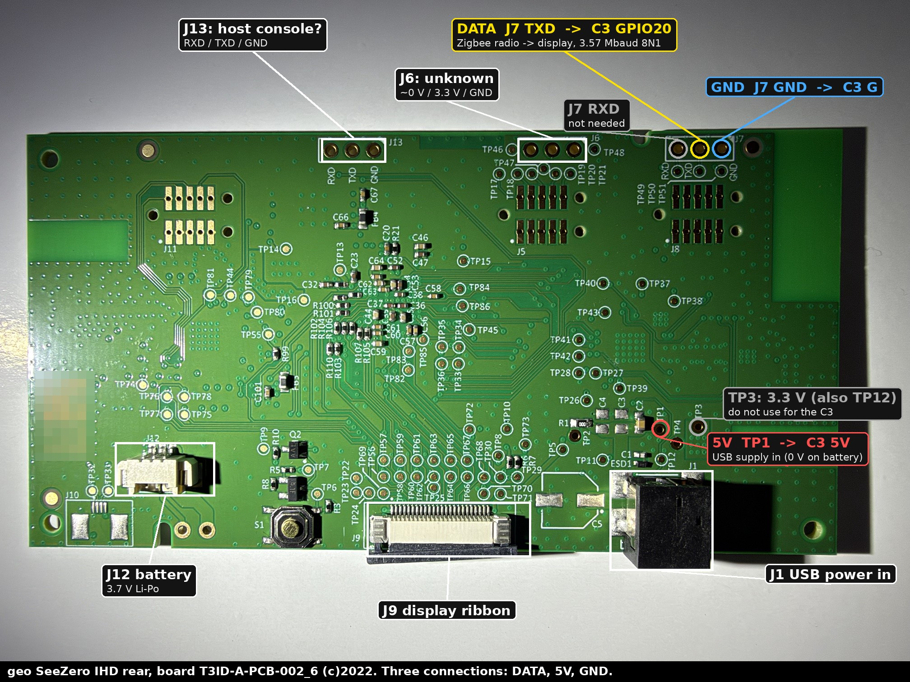
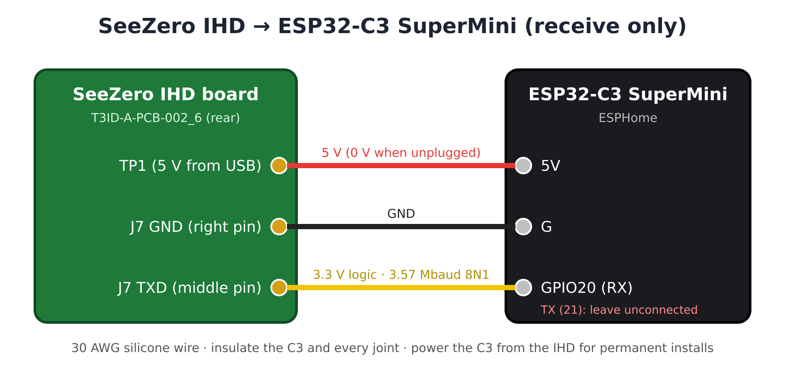
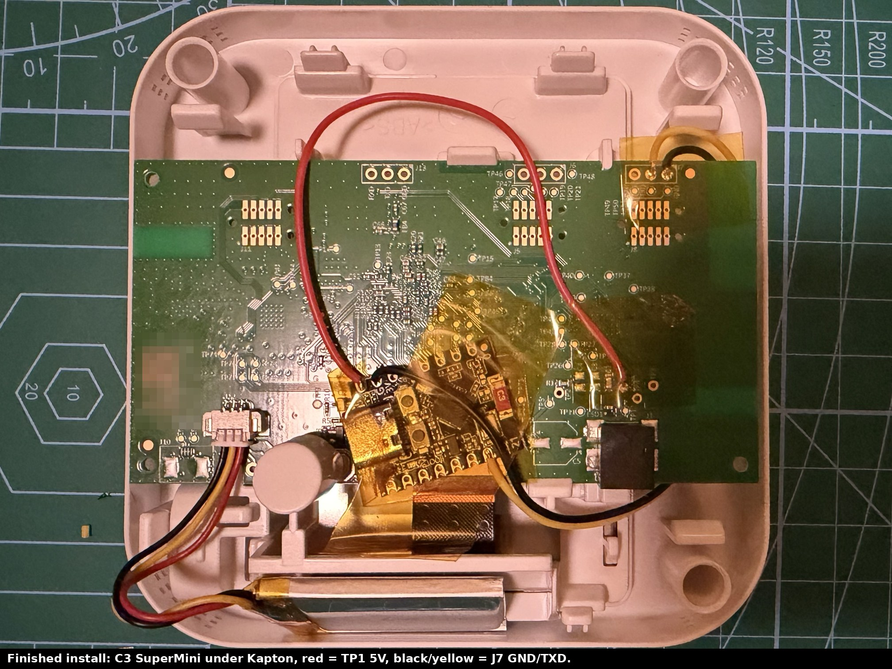

# SeeZero IHD tap: local smart meter data from a geo SeeZero

Live electricity and gas readings, costs and the tariff itself, read straight from a **geo SeeZero in-home display** by an ESP32-C3 inside its case. It needs no cloud, account or API keys, and keeps working when the internet doesn't.

This builds on two Geo Trio II projects, which showed that a geo IHD's Zigbee chip passes everything to the display over a UART you can listen to:

* [nadnerb33/geotrio2mqtt](https://github.com/nadnerb33/geotrio2mqtt) found the tap and the approach
* [gaza1994/Geo-Trio-ii-tap](https://github.com/gaza1994/Geo-Trio-ii-tap) decoded the Smart Energy attributes and the tariff

The SeeZero is a different design (NXP i.MX RT1062 + K32W041A, board `T3ID-A-PCB-002_6`). Its link runs at **~3.57 Mbaud** with its own framing, so the Trio II firmware doesn't work on it unchanged. This repo documents that link and provides an ESPHome component for it.

> **Disclaimer.** You're opening and soldering to a device connected to your energy meters. The tap only receives: the C3's TX pin isn't connected, so nothing can be sent to the IHD or the meters. You do this at your own risk. Check that the IHD is yours to modify.

## What you get

All of it matched the IHD's own screens:

| | Electricity | Gas |
|---|---|---|
| Live power | every 10 s (W, signed) | n/a |
| Meter reading | import **and export** kWh | m³ |
| Today / yesterday / this week / this month | kWh and £ | kWh and £ |
| Tariff, from the meter | unit rate, standing charge | unit rate (per kWh and per m³), standing charge, calorific value, conversion factor |
| Other | supplier messages ("Welcome to EDF Energy"), link frame and CRC-error counters, a "meter data stale" alarm | |

Costs include the standing charge and match the bill. The tariff, calorific value and conversion factor are saved in the C3's flash, so they survive a C3 reboot even when the IHD (which has a battery) doesn't restart and resend them.

## How it works

```
Smart meters ──Zigbee──► K32W041A radio ──UART 3.57 Mbaud (J7 TXD)──► i.MX RT1062 (display)
                                                   │
                                                   └──► ESP32-C3 (listens only) ──Wi-Fi──► Home Assistant
```

Every message is `AA AA | type | length | seq | payload | CRC-16/ARC`. Meter data comes as standard Zigbee Smart Energy attributes (Metering `0x0702`, Prepayment `0x0705`, Price `0x0700`), the same IDs used on the Trio II. Electricity is device 0 and gas is device 1. The full reference is in **[docs/protocol.md](docs/protocol.md)**.

## Hardware

**Parts:** ESP32-C3 SuperMini, 30 AWG silicone wire, Kapton tape, a fine soldering iron and a multimeter.



| IHD (rear of board) | ESP32-C3 SuperMini |
|---|---|
| **J7 middle pin (TXD)** | **GPIO20** |
| **J7 right pin (GND)** | **G** |
| **TP1** (5 V from USB, 0 V on battery) | **5V** |

Measure before you solder. Voltages, how to confirm the data pin with the included sniffer, and install notes are in **[docs/hardware.md](docs/hardware.md)**.





## Firmware (ESPHome)

1. In Home Assistant, install the **ESPHome Device Builder** add-on and open it.
2. Click **New device**, then **ESP32-C3**, and let it create a device. Keep the API encryption key it generates.
3. Edit the device's YAML and replace it with [`seezero-ihd.yaml`](seezero-ihd.yaml). Then:
   * point `external_components` at this repo (or see *Local install* below)
   * add `wifi_ssid`, `wifi_password` and `seezero_api_key` to ESPHome's **Secrets** (see [`secrets.example.yaml`](secrets.example.yaml))
4. **First flash:** plug the C3 into your computer by USB, then choose **Install** and **Plug into this computer** (Chrome or Edge). After that, updates go over Wi-Fi.
   * **Build killed with exit code 137?** Your Home Assistant machine ran out of memory (ESP-IDF builds are heavy). Build on a computer instead: `uv venv --python 3.13 ~/esphome-venv && uv pip install --python ~/esphome-venv esphome`, then `~/esphome-venv/bin/esphome run seezero-ihd.yaml` (with `secrets.yaml` next to it).
   * **Wi-Fi "4-Way Handshake Timeout" with the right password?** That's a known ESP32-C3 SuperMini quirk. `output_power: 8.5dB` (already in the example config) fixes it.
5. Home Assistant discovers the device. Click **Configure** and every sensor appears.

**Local install** (no GitHub): copy `components/seezero/` into `/config/esphome/components/seezero/` and use:

```yaml
external_components:
  - source:
      type: local
      path: components
```

### Energy dashboard

* **Grid consumption:** *Electricity import*. Use *Electricity unit rate* as the price entity.
* **Return to grid:** *Electricity export*.
* **Gas:** *Gas meter* (m³). Use *Gas unit rate per m³* as the price entity. The firmware works it out as unit rate × conversion factor × calorific value ÷ 3.6, all from the meter.

The Energy dashboard prices usage only. The *cost today / week / month* sensors also include standing charges, so they match the bill. Both are correct; they answer different questions.

## Tools

* [`tools/seezero_sniffer/`](tools/seezero_sniffer): an Arduino sketch for the C3. It measures the baud rate on any pin (RMT pulse timing) and prints one line per message. This is how the link was found.
* [`tools/decode_capture.py`](tools/decode_capture.py): decodes a saved sniffer log, e.g. `python3 tools/decode_capture.py samples/sanitised-capture.txt`
* [`samples/sanitised-capture.txt`](samples/sanitised-capture.txt): a real capture including the start-up burst. Frames carrying site or device IDs have been removed.

## Open questions

PRs and captures welcome:

* **Solar export:** live power is a signed value and should go negative while exporting, but that hasn't been captured yet.
* **Gas daily values** (today kWh/£) arrive in the start-up burst and also refresh on their own. The exact interval hasn't been measured.
* **Midnight:** the "yesterday" values and tariff probably resend just after midnight (they do on the Trio II); not yet confirmed. Until then, a full IHD restart (USB **and** battery) fills them in.
* **Message types `01`, `A1`, `A2`, `DA`, `E0`** look like link housekeeping. Their meaning is unknown.
* **J6 and J13:** J13 is probably the RT1062 debug console. J6's role is unknown.
* **Other SeeZero firmware or board revisions, other suppliers, and time-of-use tariffs** haven't been tested.

## Privacy

The link also carries your **MPAN and MPRN** (attribute `0x0307`) and device addresses. The firmware ignores them and `decode_capture.py` never prints them. If you share a capture, sanitise it first.

## Licence

MIT. See [LICENSE](LICENSE).
