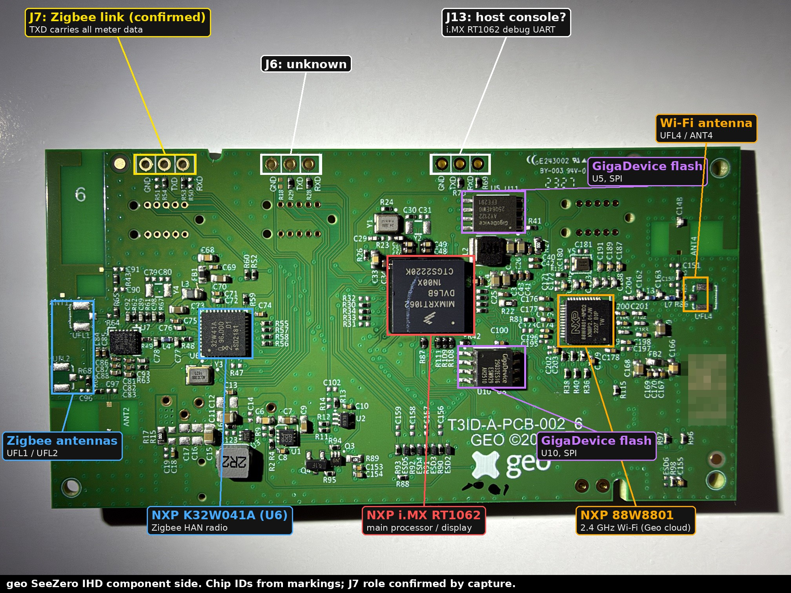
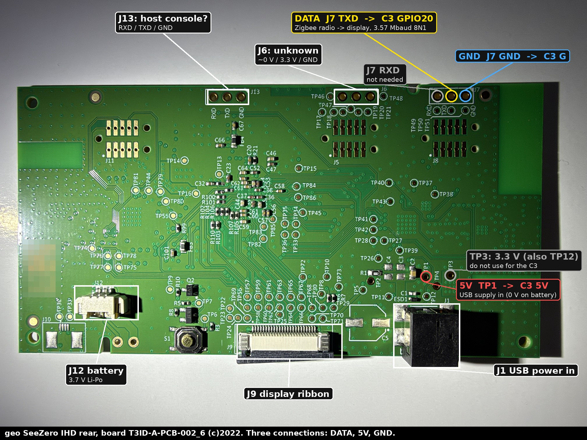
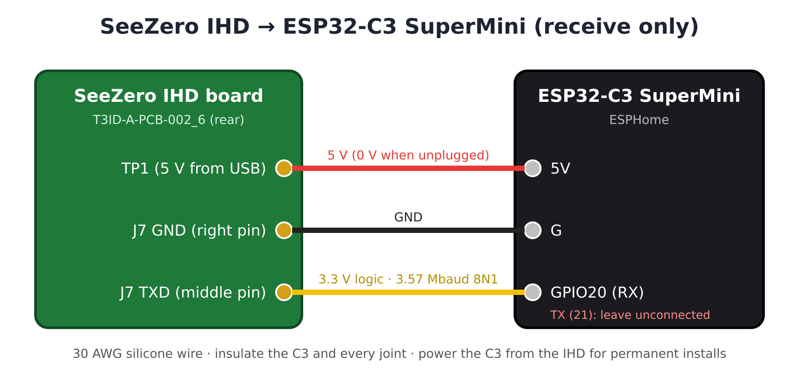
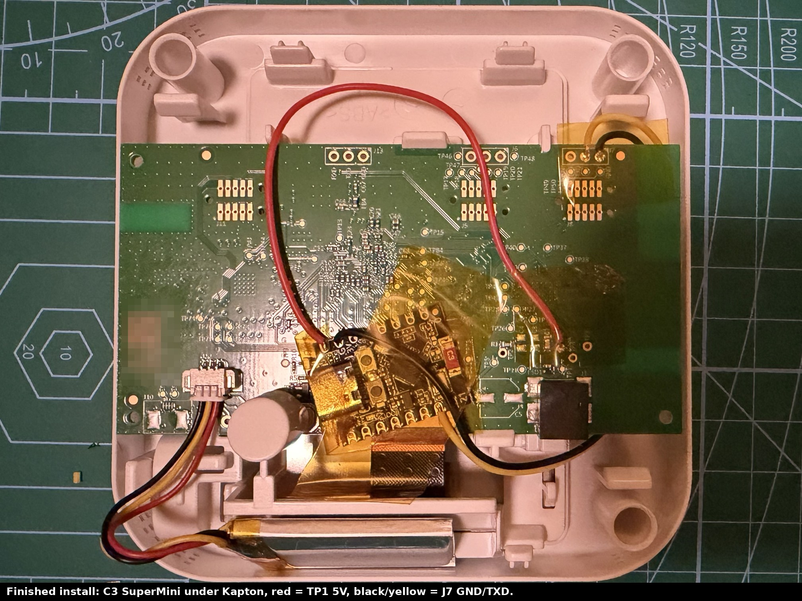

# Hardware notes: geo SeeZero IHD

## Board

* Marking: **T3ID-A-PCB-002_6, GEO ©2022** (GC1PCB 112538)
* Main processor: **NXP i.MX RT1062** (Cortex-M7), drives the display
* Zigbee HAN radio: **NXP K32W041A** (U6), antennas UFL1/UFL2
* Wi-Fi: **NXP 88W8801**, antenna UFL4/ANT4 (for the Geo cloud link)
* 2 × GigaDevice SPI flash (U5, U10)
* 3.7 V Li-Po on J12, USB power in on J1



## Headers and test points (rear)



Measured with the IHD running on USB, against J7 GND:

| Point | Reading | Role |
|---|---|---|
| J7 left (RXD) | 3.3 V steady | other direction of the Zigbee link; not needed |
| **J7 middle (TXD)** | 3.3 V idle, data bursts | **Zigbee radio → host. Tap here.** |
| J7 right (GND) | 0 V | ground |
| J6 left | 0–0.02 V | unknown |
| J6 middle | 3.3 V steady | unknown |
| J6 right | 0 V | ground |
| J13 left (RXD) | 3.26 V | probably the RT1062 debug console |
| J13 middle (TXD) | 3.3 V | |
| **TP1** | **5.0 V on USB, 0 V on battery** | **USB supply in. Power the C3 from here.** |
| TP3, TP12 | 3.3 V | board rails: don't power the C3 from these |
| TP4 | 0 V | |
| J12 red (battery +) | 4.2 V | fully charged Li-Po |

All GND pins (J6 right, J7 right, J13 right, J12 black) are connected.

Powering the C3 from TP1 means it only runs while the IHD is plugged in, so it never drains the IHD's battery. It also boots with the IHD, so it catches the start-up burst that carries the tariff and history.

## Finding the data pin without guessing

A multimeter can't see 3.6 Mbaud data; the TX pin just reads a steady 3.3 V. Use the sniffer in `tools/seezero_sniffer/`:

1. Flash it to the C3 (Arduino IDE, board "ESP32C3 Dev Module", **USB CDC On Boot: Enabled**).
2. Connect C3 **G** to J7 GND and C3 **GPIO20** to the pin under test. Power the C3 from your computer and leave its TX unconnected.
3. On start-up it times the pulses on the pin (RMT peripheral, 12.5 ns resolution), works out the baud rate, then prints one line per `AA AA` message.

On J7 middle you should see:

```
One bit = 0.2798 us  =>  about 3573360 baud.  100% of pulses are whole bits.
[  22.073 s]  49 B: AA AA B0 29 00 3E 00 02 07 00 00 04 03 00 16 01 00 ...
```

`tools/decode_capture.py` turns a saved log into readings.

## Wiring



| IHD | ESP32-C3 SuperMini |
|---|---|
| TP1 (5 V) | 5V |
| J7 right (GND) | G |
| J7 middle (TXD) | GPIO20 |
| | TX/GPIO21: **not connected** (receive only) |



Use 30 AWG silicone wire. Insulate both sides of the C3 (Kapton) and every joint, keep the C3 and its wires away from the antenna areas (the plain green zones at the board edges and the UFL connectors), and make sure nothing pulls on the J7 joints when the case closes.

## Power and Wi-Fi notes

* The C3 draws roughly 0.5 W with Wi-Fi on (that's the Trio II project's figure). Check that the IHD's USB supply copes.
* The SuperMini's ceramic antenna is weak inside a closed case. Check **WiFi signal** in Home Assistant before you seal it up.
